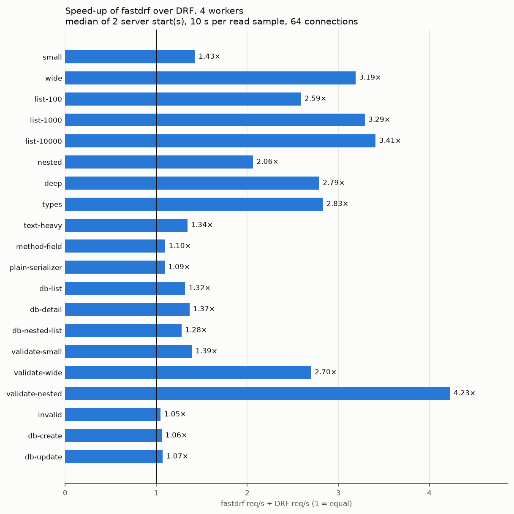

# fastdrf-benchmarks

HTTP benchmarks of one API served twice: by Django REST framework with its
default configuration, and by the same code with the optimizations of
[django-fastdrf](https://github.com/ctolon/django-fastdrf). Twenty endpoints
cover JSON output of many shapes and sizes, input validation, and reads and
writes against PostgreSQL. Both servers answer every request with the same
status, headers and body bytes, checked before and after every measurement.

The benchmarks measure django-fastdrf 0.1.0, installed from PyPI.

| | |
| --- | --- |
| Profiles | `drf`: Django REST framework 3.18 with no `REST_FRAMEWORK` setting; `fastdrf`: the same API with django-fastdrf 0.1.0 ([settings and classes](docs/methodology.md#fastdrf)) |
| Software | CPython 3.14 (GIL build), Django 6.1, DRF 3.18, Gunicorn 26 (gthread worker), PostgreSQL 18; `requirements.lock` pins every package |
| Server | 1 and 4 Gunicorn workers, each pinned to its own CPU, 8 threads per worker, keep-alive |
| Load | [oha](https://github.com/hatoo/oha), 64 connections, on CPUs of its own |
| Results | the median of independent server starts, with the spread between them, per case and worker count |

## Latest results

[REPORT.md](REPORT.md) is the run of 1 October 2026: 20 cases, both
profiles, 1 and 4 workers, two server starts per group. All 80 groups are
valid, the median spread between starts is 1.2%, and neither PostgreSQL
(at most 35% of its CPUs) nor oha (at most 3%) limited the throughput.

| | |
| --- | --- |
| Host | Intel Core i7-14700F (8 performance and 12 efficiency cores, 28 logical CPUs), 123 GiB of memory, CPU frequency governor `powersave` |
| Software | Linux 7.0.0, CPython 3.14.7 (GIL build), Django 6.1.1, DRF 3.18.1, django-fastdrf 0.1.0, msgspec 0.22.0, Gunicorn 26.2.0, PostgreSQL 18.6 |
| Duration | 10 s per read sample after a 2 s warmup, 2,000 requests per write sample, 64 connections; 33 minutes in total |

At four workers, fastdrf served:

| Requests per second over DRF's | Cases |
| --- | --- |
| 2.1 to 4.2 times | lists (`list-100`, `list-1000`, `list-10000`), wide and nested objects (`wide`, `nested`, `deep`), typed values (`types`), and the validation of wide and nested input (`validate-wide`, `validate-nested`) |
| 1.3 to 1.4 times | a small object (`small`), small input (`validate-small`), long strings (`text-heavy`) and the PostgreSQL reads (`db-list`, `db-detail`, `db-nested-list`) |
| 1.05 to 1.10 times | the writes (`db-create`, `db-update`) and the cases fastdrf leaves to DRF's serializer code (`method-field`, `plain-serializer`, `invalid`) |

At one worker the ratios differ from these by about 10% at most.



The numbers hold for this host and these settings; compare the two profiles
within a run.

## Cases

| Kind | Cases |
| --- | --- |
| Output of in-memory objects (serializer and renderer only) | `small` (5 fields), `wide` (50 fields), `list-100`, `list-1000`, `list-10000`, `nested` (an object with a nested object and a list of 10), `deep` (5 levels), `types` (datetimes, dates, times, decimals, UUIDs, nulls, choices), `text-heavy` (four 10,000-character Unicode strings), `method-field` (a `SerializerMethodField`), `plain-serializer` (a `Serializer` without a model) |
| Output from PostgreSQL | `db-list` (a page of 20 articles with author and tags), `db-detail`, `db-nested-list` (authors with their articles and tags) |
| Input validation | `validate-small`, `validate-wide`, `validate-nested` (100 nested items), `invalid` (DRF's 400 error body) |
| Writes to PostgreSQL | `db-create` (foreign key and many-to-many), `db-update` (partial update) |

[Cases](docs/cases.md) lists every endpoint with its request and response
sizes, its SQL and what fastdrf does for it. Two cases are there to show
where fastdrf does not compile the output: `method-field` and
`plain-serializer` are served by DRF's serializer code in both profiles, and
measure only what the rest of fastdrf (field caching, rendering, dispatch)
changes.

## Running

You need Linux, Docker with Compose, [uv](https://docs.astral.sh/uv/) and
oha on the `PATH`.

```sh
uv venv --python 3.14 .venv
uv pip sync --python .venv/bin/python requirements.lock
uv pip install --python .venv/bin/python --no-deps -e .
scripts/run.sh
```

`scripts/run.sh` starts PostgreSQL (`docker compose -p fastdrf-benchmarks`,
port 55451), writes the benchmark rows, measures every case with both
profiles at 1 and 4 workers, and writes the report to `results/<run>/`.
Settings are environment variables, and further arguments go to
`fastdrf-bench run`:

| Variable | Default | Meaning |
| --- | --- | --- |
| `REPEATS` | 2 | Server starts per case, profile and worker count |
| `DURATION` | 10 | Seconds per read or validation sample |
| `WARMUP` | 2 | Seconds of warmup per sample |
| `CONCURRENCY` | 64 | Requests in flight |
| `WRITE_REQUESTS` | 2000 | Requests per write sample |
| `WORKERS` | `1 4` | Worker counts |
| `THREADS` | 8 | Gunicorn threads per worker |
| `SERVER_CPUS` | `0,2,4,6` | Server CPUs, one per worker |
| `LOAD_CPUS` | `8-15` | oha's CPUs |
| `BENCH_PG_CPUS` | `16-19` | PostgreSQL's CPUs |
| `OUTPUT` | `results/run-<time>` | Run directory |
| `SMOKE` | 0 | 1: one start, 2 s, 1 worker, 200 writes; a check that everything runs |

```sh
scripts/run.sh --cases small list-1000 db-list
SMOKE=1 scripts/run.sh --cases small db-create
REPEATS=3 WORKERS=4 scripts/run.sh
```

The default CPU layout is for an Intel Core i7-14700F (8 performance cores,
12 efficiency cores); see [methodology](docs/methodology.md#cpu-layout) for
other hosts. Run on a quiet machine.

## Reading the results

Each run directory holds:

- `REPORT.md`: the speed-up chart per worker count, a table of every case
  with DRF's and fastdrf's requests per second and their ratio, and a section
  per case with its chart, requests per second, spread, p50 and p99 latency,
  server CPU, PostgreSQL CPU and oha CPU.
- `summary.csv`: the numbers of every group (case, profile, workers).
- `samples.json`: every sample, valid or not.
- `manifest.json`: the parameters, host, package versions, the installed
  django-fastdrf version with a digest of its source, both profiles'
  settings, the server commands, PostgreSQL's settings and what fastdrf does
  per case.
- `graphs/`: the charts.
- one directory per sample: oha's output and command, the server log and the
  resource samples.

The speed-up is fastdrf's requests per second divided by DRF's at the same
worker count. A group whose PostgreSQL or oha used 80% or more of its CPUs is
marked: there, the database or the load generator may have limited the
throughput. Numbers hold for the host and settings of the run; compare the
profiles within a run, not with runs on other machines.

## Method

[Methodology](docs/methodology.md) describes the profiles and the reason for
each fastdrf option, how parity is enforced, the steps of a sample, the CPU
layout and the limits of the measurements:

- Both profiles answer the bytes recorded in `bench/expected.json`, checked
  in-process by the tests and on the real server before and after every
  sample.
- The database cases run the same SQL statements in both profiles; the tests
  compare them.
- Every sample starts a new server; write samples send a fixed number of
  requests, and the rows are written again before and after them.
- The configuration order is shuffled per case with a recorded seed.

## Development

```sh
uv pip install --python .venv/bin/python --group dev
.venv/bin/ruff check . && .venv/bin/ruff format --check .
BENCH_DATABASE=sqlite .venv/bin/pytest -q
```

See [contributing](CONTRIBUTING.md) for the real-server tests and for adding
cases.

## License

BSD 3-Clause; see [LICENSE](LICENSE).
