# Benchmark report

State: complete. 20 cases, profiles drf and fastdrf, 1, 4 worker(s), 2 server start(s) per group: 80 of 80 groups complete.

## Reading this report

- `drf` is Django REST framework with its default configuration; `fastdrf` is the same API with django-fastdrf's optimizations. Both answer every case with the same status, headers and body bytes, checked before and after every sample.
- Every number is the median over independent server starts. Spread is half the range between the fastest and slowest start, relative to the median.
- Speed-up is fastdrf's requests per second divided by DRF's, at the same worker count. Above 1, fastdrf served more requests.
- CPU % is the server process tree's mean CPU (100% = one CPU). PostgreSQL and load generator columns are their CPU use relative to the CPUs they have; at 80% or more (⚠) they, rather than the server, may have limited the throughput.
- The fastdrf column says whether fastdrf compiled the output and recognized the input of the case, or left it to DRF.

## Speed-up

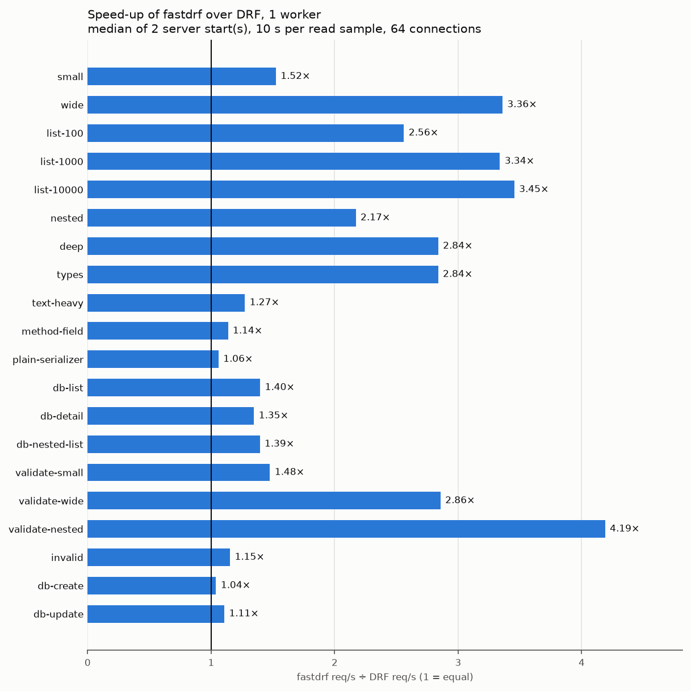

| Case | Kind | 1w DRF req/s | 1w fastdrf req/s | 1w speed-up | 4w DRF req/s | 4w fastdrf req/s | 4w speed-up | fastdrf |
| --- | --- | ---: | ---: | ---: | ---: | ---: | ---: | --- |
| [small](#small) | output | 2,911 | 4,436 | 1.52× | 9,683 | 13,804 | 1.43× | output compiled |
| [wide](#wide) | output | 1,093 | 3,673 | 3.36× | 3,733 | 11,905 | 3.19× | output compiled |
| [list-100](#list-100) | output | 726 | 1,858 | 2.56× | 2,454 | 6,355 | 2.59× | output compiled |
| [list-1000](#list-1000) | output | 108 | 362 | 3.34× | 358 | 1,179 | 3.29× | output compiled |
| [list-10000](#list-10000) | output | 11 | 39 | 3.45× | 36 | 121 | 3.41× | output compiled |
| [nested](#nested) | output | 1,517 | 3,294 | 2.17× | 5,141 | 10,607 | 2.06× | output compiled |
| [deep](#deep) | output | 789 | 2,240 | 2.84× | 2,643 | 7,376 | 2.79× | output compiled |
| [types](#types) | output | 477 | 1,353 | 2.84× | 1,599 | 4,527 | 2.83× | output compiled |
| [text-heavy](#text-heavy) | output | 1,517 | 1,932 | 1.27× | 4,888 | 6,564 | 1.34× | output compiled |
| [method-field](#method-field) | output | 679 | 772 | 1.14× | 2,288 | 2,515 | 1.10× | output DRF |
| [plain-serializer](#plain-serializer) | output | 964 | 1,022 | 1.06× | 3,213 | 3,508 | 1.09× | output DRF |
| [db-list](#db-list) | database | 332 | 464 | 1.40× | 1,100 | 1,449 | 1.32× | output compiled |
| [db-detail](#db-detail) | database | 665 | 896 | 1.35× | 2,171 | 2,965 | 1.37× | output compiled |
| [db-nested-list](#db-nested-list) | database | 127 | 177 | 1.39× | 413 | 528 | 1.28× | output compiled |
| [validate-small](#validate-small) | input | 2,802 | 4,137 | 1.48× | 9,340 | 13,002 | 1.39× | input compiled |
| [validate-wide](#validate-wide) | input | 1,214 | 3,469 | 2.86× | 4,140 | 11,185 | 2.70× | input compiled |
| [validate-nested](#validate-nested) | input | 304 | 1,274 | 4.19× | 983 | 4,158 | 4.23× | input compiled |
| [invalid](#invalid) | input | 966 | 1,114 | 1.15× | 3,396 | 3,558 | 1.05× | input DRF |
| [db-create](#db-create) | write | 382 | 397 | 1.04× | 1,202 | 1,274 | 1.06× | output compiled, input DRF |
| [db-update](#db-update) | write | 443 | 491 | 1.11× | 1,466 | 1,572 | 1.07× | output compiled, input DRF |

## Headroom

PostgreSQL stayed below 80% of its CPUs in every group.

oha stayed below 80% of its CPUs in every group.

## Cases

### Output of in-memory objects

#### small

One object with 5 scalar fields. `GET /out/small/`, 84 response bytes.

fastdrf: serializer `SmallSerializer`; output compiled.

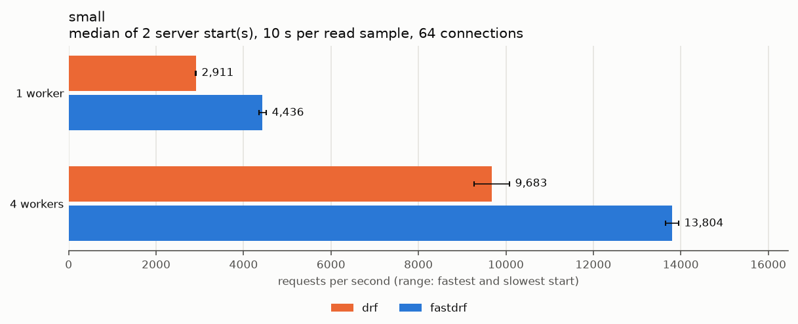

| Profile | Workers | req/s | Spread | p50 ms | p99 ms | CPU % | PostgreSQL | oha |
| --- | ---: | ---: | ---: | ---: | ---: | ---: | ---: | ---: |
| drf | 1 | 2,911 | ±0.2% | 19.26 | 71.12 | 98 | 1% | 1% |
| fastdrf | 1 | 4,436 | ±2.0% | 12.86 | 52.32 | 98 | 1% | 1% |
| drf | 4 | 9,683 | ±4.2% | 4.16 | 41.05 | 394 | 1% | 2% |
| fastdrf | 4 | 13,804 | ±1.1% | 2.28 | 31.20 | 396 | 1% | 3% |

#### wide

One object with 50 fields: strings, integers, floats, booleans, dates, datetimes, decimals and a UUID. `GET /out/wide/`, 1,310 response bytes.

fastdrf: serializer `WideSerializer`; output compiled.

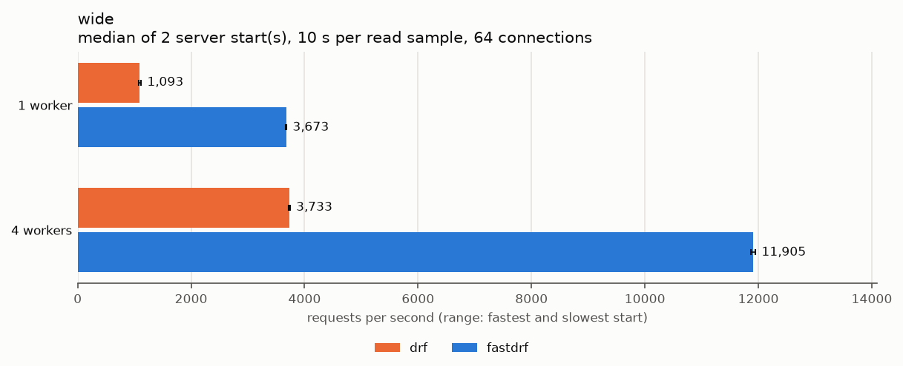

| Profile | Workers | req/s | Spread | p50 ms | p99 ms | CPU % | PostgreSQL | oha |
| --- | ---: | ---: | ---: | ---: | ---: | ---: | ---: | ---: |
| drf | 1 | 1,093 | ±2.1% | 50.61 | 130.57 | 100 | 1% | 0% |
| fastdrf | 1 | 3,673 | ±0.2% | 15.45 | 60.02 | 98 | 1% | 1% |
| drf | 4 | 3,733 | ±0.2% | 11.25 | 74.08 | 395 | 1% | 1% |
| fastdrf | 4 | 11,905 | ±0.4% | 3.28 | 32.00 | 395 | 1% | 2% |

#### list-100

100 flat objects with 10 fields each. `GET /out/list-100/`, 20,976 response bytes.

fastdrf: serializer `ItemSerializer`; output compiled.

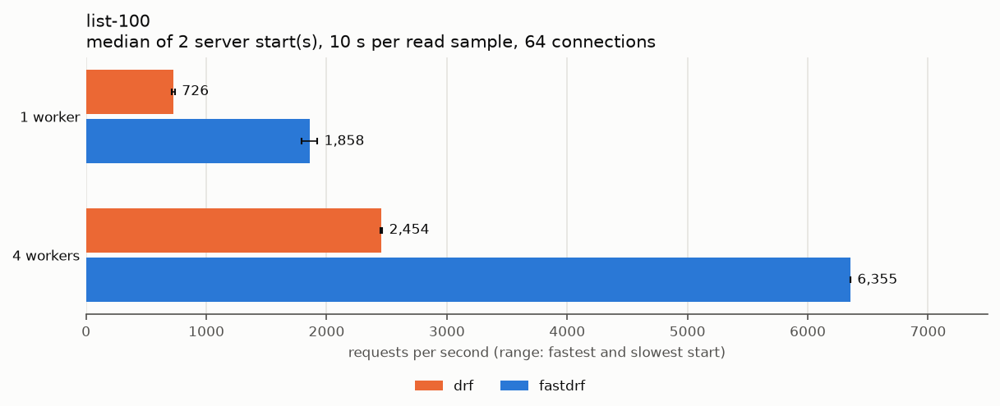

| Profile | Workers | req/s | Spread | p50 ms | p99 ms | CPU % | PostgreSQL | oha |
| --- | ---: | ---: | ---: | ---: | ---: | ---: | ---: | ---: |
| drf | 1 | 726 | ±1.9% | 79.08 | 160.73 | 98 | 1% | 0% |
| fastdrf | 1 | 1,858 | ±3.5% | 30.66 | 92.16 | 98 | 1% | 1% |
| drf | 4 | 2,454 | ±0.4% | 16.78 | 105.41 | 394 | 1% | 1% |
| fastdrf | 4 | 6,355 | ±0.0% | 4.77 | 50.87 | 396 | 1% | 2% |

#### list-1000

1,000 flat objects with 10 fields each. `GET /out/list-1000/`, 210,588 response bytes.

fastdrf: serializer `ItemSerializer`; output compiled.

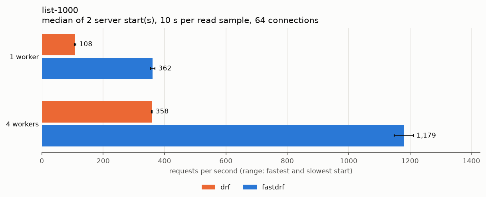

| Profile | Workers | req/s | Spread | p50 ms | p99 ms | CPU % | PostgreSQL | oha |
| --- | ---: | ---: | ---: | ---: | ---: | ---: | ---: | ---: |
| drf | 1 | 108 | ±2.6% | 576.82 | 780.36 | 98 | 1% | 0% |
| fastdrf | 1 | 362 | ±2.1% | 168.81 | 257.53 | 99 | 1% | 0% |
| drf | 4 | 358 | ±0.4% | 110.92 | 545.45 | 388 | 1% | 0% |
| fastdrf | 4 | 1,179 | ±2.6% | 32.28 | 192.24 | 394 | 1% | 1% |

#### list-10000

10,000 flat objects with 10 fields each. `GET /out/list-10000/`, 2,116,150 response bytes.

fastdrf: serializer `ItemSerializer`; output compiled.

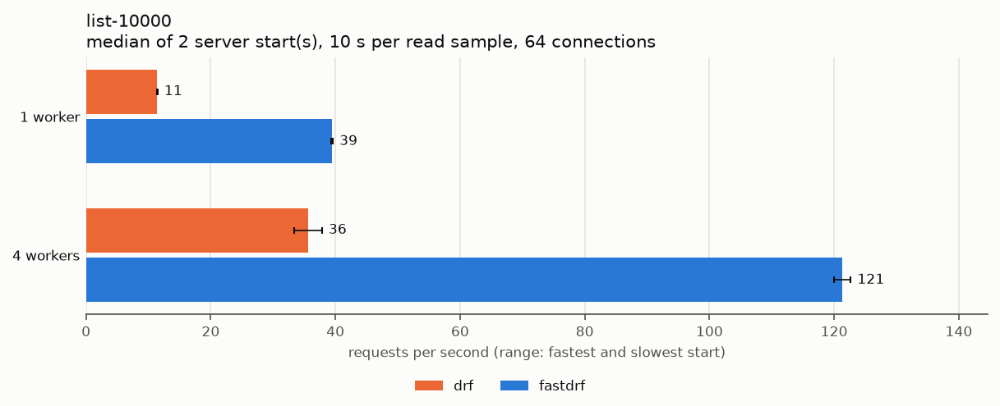

| Profile | Workers | req/s | Spread | p50 ms | p99 ms | CPU % | PostgreSQL | oha |
| --- | ---: | ---: | ---: | ---: | ---: | ---: | ---: | ---: |
| drf | 1 | 11 | ±0.4% | 5,413.82 | 6,380.86 | 100 | 1% | 0% |
| fastdrf | 1 | 39 | ±0.3% | 1,583.68 | 1,923.67 | 99 | 1% | 0% |
| drf | 4 | 36 | ±6.3% | 1,229.42 | 3,957.37 | 348 | 1% | 0% |
| fastdrf | 4 | 121 | ±1.1% | 343.00 | 1,401.41 | 375 | 1% | 0% |

#### nested

An order with its customer (nested object) and 10 lines (nested list). `GET /out/nested/`, 1,113 response bytes.

fastdrf: serializer `OrderSerializer`; output compiled.

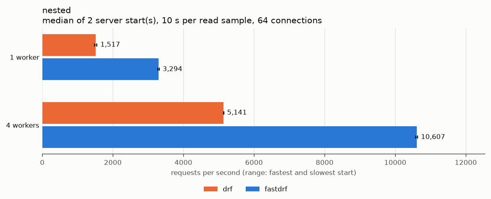

| Profile | Workers | req/s | Spread | p50 ms | p99 ms | CPU % | PostgreSQL | oha |
| --- | ---: | ---: | ---: | ---: | ---: | ---: | ---: | ---: |
| drf | 1 | 1,517 | ±2.3% | 37.02 | 106.46 | 99 | 1% | 0% |
| fastdrf | 1 | 3,294 | ±0.6% | 17.23 | 64.71 | 99 | 1% | 1% |
| drf | 4 | 5,141 | ±0.0% | 6.97 | 62.13 | 396 | 1% | 1% |
| fastdrf | 4 | 10,607 | ±0.3% | 3.96 | 37.61 | 394 | 1% | 2% |

#### deep

A tree five levels deep, three children per node: 121 nested objects. `GET /out/deep/`, 8,390 response bytes.

fastdrf: serializer `TreeSerializer`; output compiled.

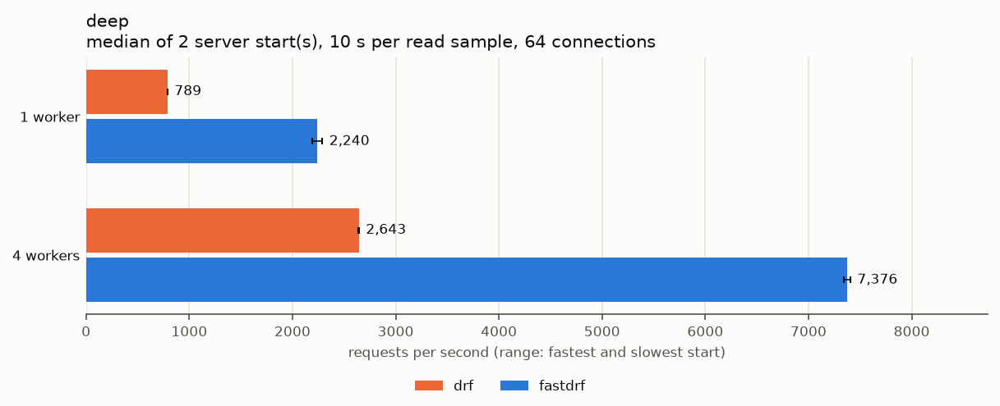

| Profile | Workers | req/s | Spread | p50 ms | p99 ms | CPU % | PostgreSQL | oha |
| --- | ---: | ---: | ---: | ---: | ---: | ---: | ---: | ---: |
| drf | 1 | 789 | ±0.1% | 71.29 | 155.31 | 98 | 1% | 0% |
| fastdrf | 1 | 2,240 | ±2.3% | 25.47 | 83.31 | 99 | 1% | 1% |
| drf | 4 | 2,643 | ±0.1% | 21.52 | 100.56 | 397 | 1% | 1% |
| fastdrf | 4 | 7,376 | ±0.4% | 7.41 | 50.51 | 395 | 1% | 2% |

#### types

100 objects of datetimes in three time zones, dates, times, decimals, UUIDs, booleans, nulls, choices, integers and floats. `GET /out/types/`, 28,302 response bytes.

fastdrf: serializer `TypedSerializer`; output compiled.

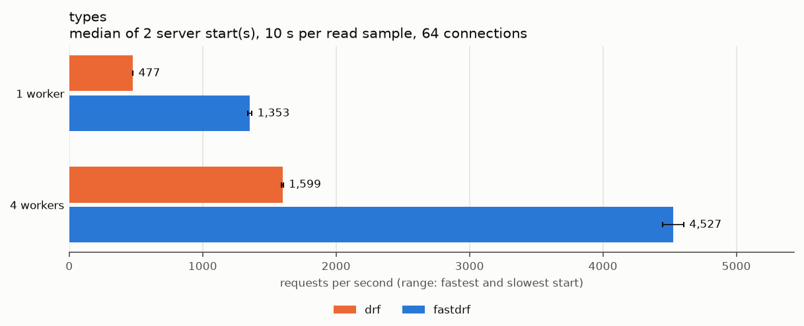

| Profile | Workers | req/s | Spread | p50 ms | p99 ms | CPU % | PostgreSQL | oha |
| --- | ---: | ---: | ---: | ---: | ---: | ---: | ---: | ---: |
| drf | 1 | 477 | ±0.3% | 124.50 | 210.93 | 99 | 1% | 0% |
| fastdrf | 1 | 1,353 | ±1.2% | 42.29 | 109.85 | 99 | 1% | 0% |
| drf | 4 | 1,599 | ±0.4% | 19.29 | 159.86 | 391 | 1% | 1% |
| fastdrf | 4 | 4,527 | ±1.8% | 10.46 | 65.31 | 396 | 1% | 1% |

#### text-heavy

Four strings of 10,000 characters: Latin with diacritics, Greek, CJK, and a mix with emoji, escapes and line separators. `GET /out/text-heavy/`, 77,712 response bytes.

fastdrf: serializer `DocumentSerializer`; output compiled.

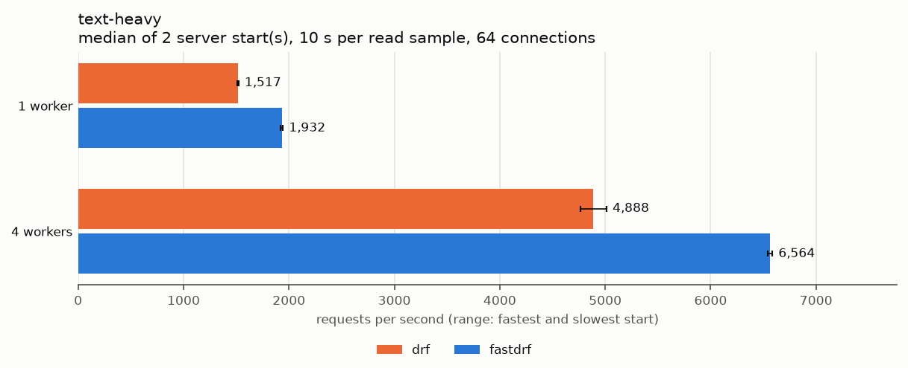

| Profile | Workers | req/s | Spread | p50 ms | p99 ms | CPU % | PostgreSQL | oha |
| --- | ---: | ---: | ---: | ---: | ---: | ---: | ---: | ---: |
| drf | 1 | 1,517 | ±0.3% | 37.14 | 104.29 | 98 | 1% | 1% |
| fastdrf | 1 | 1,932 | ±0.5% | 29.47 | 91.21 | 98 | 1% | 1% |
| drf | 4 | 4,888 | ±2.5% | 7.93 | 67.14 | 393 | 1% | 2% |
| fastdrf | 4 | 6,564 | ±0.3% | 4.93 | 48.80 | 396 | 1% | 2% |

#### method-field

The list-100 objects with a SerializerMethodField, which fastdrf leaves to DRF. `GET /out/method-field/`, 25,877 response bytes.

fastdrf: serializer `LabelledItemSerializer`; output DRF: LabelledItemSerializer.label has source='*'.

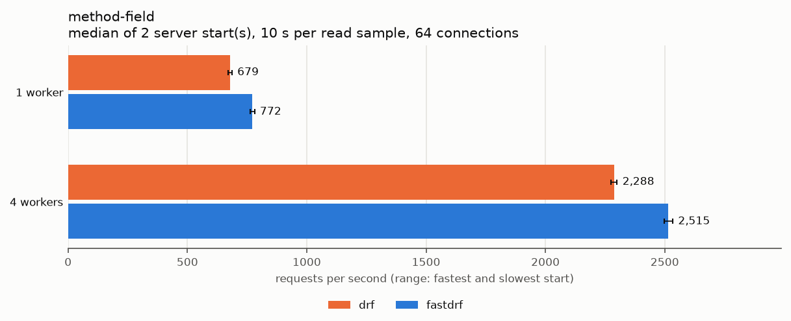

| Profile | Workers | req/s | Spread | p50 ms | p99 ms | CPU % | PostgreSQL | oha |
| --- | ---: | ---: | ---: | ---: | ---: | ---: | ---: | ---: |
| drf | 1 | 679 | ±1.1% | 85.10 | 168.35 | 99 | 1% | 0% |
| fastdrf | 1 | 772 | ±1.2% | 74.48 | 152.58 | 98 | 1% | 0% |
| drf | 4 | 2,288 | ±0.5% | 19.82 | 110.55 | 396 | 1% | 1% |
| fastdrf | 4 | 2,515 | ±0.7% | 11.81 | 102.79 | 395 | 1% | 1% |

#### plain-serializer

100 dictionaries through a plain Serializer, which strict parity leaves to DRF. `GET /out/plain-serializer/`, 19,285 response bytes.

fastdrf: serializer `PlainItemSerializer`; output DRF: PlainItemSerializer is not a ModelSerializer.

| Profile | Workers | req/s | Spread | p50 ms | p99 ms | CPU % | PostgreSQL | oha |
| --- | ---: | ---: | ---: | ---: | ---: | ---: | ---: | ---: |
| drf | 1 | 964 | ±2.6% | 58.76 | 138.03 | 99 | 1% | 0% |
| fastdrf | 1 | 1,022 | ±4.0% | 55.83 | 131.90 | 99 | 1% | 0% |
| drf | 4 | 3,213 | ±2.5% | 7.27 | 102.47 | 396 | 1% | 1% |
| fastdrf | 4 | 3,508 | ±0.7% | 13.55 | 72.99 | 394 | 1% | 1% |

### Output from PostgreSQL

#### db-list

A page of 20 articles with their author (foreign key) and tags (many-to-many), and the count. `GET /db/articles/`, 12,928 response bytes, 3 SQL queries per request in both profiles.

fastdrf: serializer `ArticleSerializer`; output compiled.

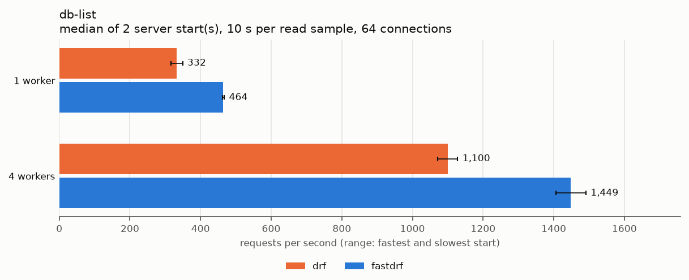

| Profile | Workers | req/s | Spread | p50 ms | p99 ms | CPU % | PostgreSQL | oha |
| --- | ---: | ---: | ---: | ---: | ---: | ---: | ---: | ---: |
| drf | 1 | 332 | ±5.1% | 188.63 | 244.16 | 99 | 5% | 0% |
| fastdrf | 1 | 464 | ±0.6% | 135.47 | 170.43 | 99 | 7% | 0% |
| drf | 4 | 1,100 | ±2.6% | 45.28 | 154.36 | 389 | 19% | 0% |
| fastdrf | 4 | 1,449 | ±2.9% | 33.85 | 118.21 | 393 | 25% | 1% |

#### db-detail

One article with its author and tags. `GET /db/articles/1/`, 632 response bytes, 2 SQL queries per request in both profiles.

fastdrf: serializer `ArticleSerializer`; output compiled.

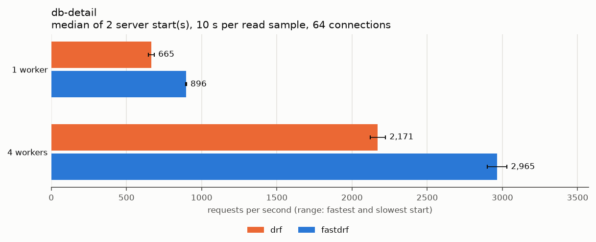

| Profile | Workers | req/s | Spread | p50 ms | p99 ms | CPU % | PostgreSQL | oha |
| --- | ---: | ---: | ---: | ---: | ---: | ---: | ---: | ---: |
| drf | 1 | 665 | ±3.0% | 94.17 | 127.27 | 99 | 5% | 0% |
| fastdrf | 1 | 896 | ±0.4% | 70.41 | 90.09 | 98 | 7% | 0% |
| drf | 4 | 2,171 | ±2.4% | 32.82 | 65.79 | 385 | 19% | 1% |
| fastdrf | 4 | 2,965 | ±2.2% | 17.60 | 53.19 | 391 | 26% | 1% |

#### db-nested-list

10 authors, each with 10 articles and their tags (to-many, two levels). `GET /db/authors/`, 20,866 response bytes, 3 SQL queries per request in both profiles.

fastdrf: serializer `AuthorWithArticlesSerializer`; output compiled.

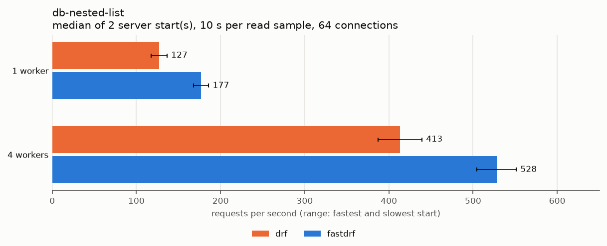

| Profile | Workers | req/s | Spread | p50 ms | p99 ms | CPU % | PostgreSQL | oha |
| --- | ---: | ---: | ---: | ---: | ---: | ---: | ---: | ---: |
| drf | 1 | 127 | ±7.5% | 504.76 | 613.49 | 98 | 3% | 0% |
| fastdrf | 1 | 177 | ±5.1% | 355.85 | 446.48 | 100 | 4% | 0% |
| drf | 4 | 413 | ±6.3% | 78.51 | 492.86 | 389 | 11% | 0% |
| fastdrf | 4 | 528 | ±4.4% | 91.67 | 322.25 | 387 | 14% | 0% |

### Input validation

#### validate-small

5 fields validated; the validated data is returned. `POST /in/small/`, 75 response bytes, 75 request bytes.

fastdrf: serializer `SmallInputSerializer`; input recognized.

| Profile | Workers | req/s | Spread | p50 ms | p99 ms | CPU % | PostgreSQL | oha |
| --- | ---: | ---: | ---: | ---: | ---: | ---: | ---: | ---: |
| drf | 1 | 2,802 | ±1.6% | 20.03 | 72.27 | 98 | 1% | 1% |
| fastdrf | 1 | 4,137 | ±1.0% | 13.75 | 55.13 | 97 | 1% | 1% |
| drf | 4 | 9,340 | ±0.3% | 4.41 | 42.71 | 395 | 1% | 2% |
| fastdrf | 4 | 13,002 | ±1.6% | 2.82 | 29.75 | 394 | 1% | 3% |

#### validate-wide

50 fields validated; the validated data is returned. `POST /in/wide/`, 1,304 response bytes, 1,304 request bytes.

fastdrf: serializer `WideInputSerializer`; input recognized.

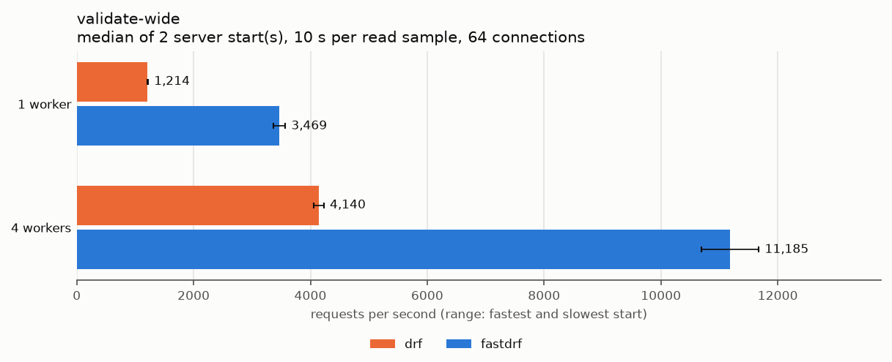

| Profile | Workers | req/s | Spread | p50 ms | p99 ms | CPU % | PostgreSQL | oha |
| --- | ---: | ---: | ---: | ---: | ---: | ---: | ---: | ---: |
| drf | 1 | 1,214 | ±0.4% | 46.04 | 121.51 | 99 | 1% | 0% |
| fastdrf | 1 | 3,469 | ±2.8% | 16.44 | 62.19 | 98 | 1% | 1% |
| drf | 4 | 4,140 | ±2.1% | 7.96 | 71.29 | 394 | 1% | 1% |
| fastdrf | 4 | 11,185 | ±4.4% | 4.31 | 33.86 | 393 | 1% | 3% |

#### validate-nested

A batch of 100 nested lines, each with a nested object and a list, validated and returned. `POST /in/nested/`, 22,350 response bytes, 22,350 request bytes.

fastdrf: serializer `BatchSerializer`; input recognized.

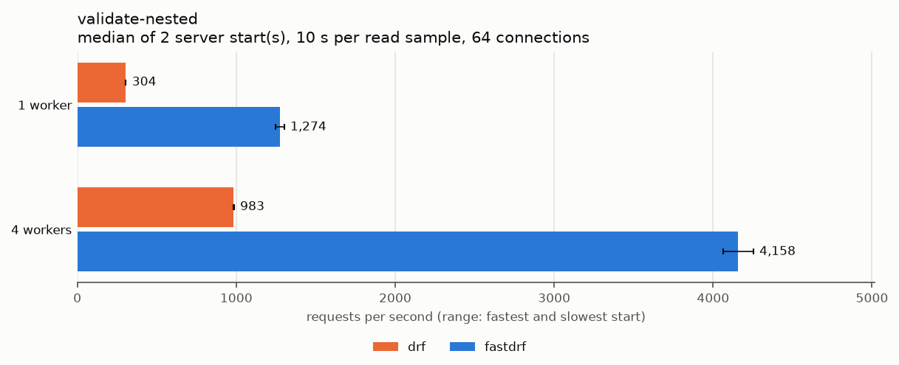

| Profile | Workers | req/s | Spread | p50 ms | p99 ms | CPU % | PostgreSQL | oha |
| --- | ---: | ---: | ---: | ---: | ---: | ---: | ---: | ---: |
| drf | 1 | 304 | ±0.3% | 203.06 | 300.25 | 99 | 1% | 0% |
| fastdrf | 1 | 1,274 | ±2.1% | 44.99 | 115.44 | 99 | 1% | 0% |
| drf | 4 | 983 | ±0.2% | 59.94 | 173.70 | 394 | 1% | 1% |
| fastdrf | 4 | 4,158 | ±2.3% | 9.09 | 75.57 | 393 | 1% | 1% |

#### invalid

The wide body with 10 invalid and 3 missing fields: DRF's 400 error body. `POST /in/wide/`, 645 response bytes, 1,252 request bytes.

fastdrf: serializer `WideInputSerializer`; input DRF: the recognizer does not accept invalid input.

| Profile | Workers | req/s | Spread | p50 ms | p99 ms | CPU % | PostgreSQL | oha |
| --- | ---: | ---: | ---: | ---: | ---: | ---: | ---: | ---: |
| drf | 1 | 966 | ±0.1% | 59.64 | 124.78 | 99 | 1% | 0% |
| fastdrf | 1 | 1,114 | ±0.4% | 50.64 | 125.50 | 98 | 1% | 0% |
| drf | 4 | 3,396 | ±0.2% | 11.45 | 94.78 | 395 | 1% | 1% |
| fastdrf | 4 | 3,558 | ±4.0% | 12.12 | 78.75 | 392 | 1% | 1% |

### Writes to PostgreSQL

#### db-create

An article created with an author and three tags; the nested article is returned. `POST /db/articles/`, 298 response bytes, 190 request bytes, 8 SQL queries per request in both profiles.

fastdrf: serializer `ArticleSerializer`; output compiled; input DRF: ArticleSerializer.price is a DecimalField.

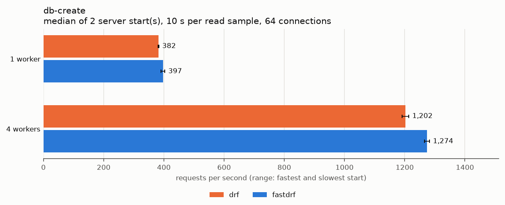

| Profile | Workers | req/s | Spread | p50 ms | p99 ms | CPU % | PostgreSQL | oha |
| --- | ---: | ---: | ---: | ---: | ---: | ---: | ---: | ---: |
| drf | 1 | 382 | ±0.4% | 165.31 | 194.30 | 96 | 9% | 0% |
| fastdrf | 1 | 397 | ±1.6% | 158.60 | 190.22 | 99 | 9% | 0% |
| drf | 4 | 1,202 | ±1.0% | 41.94 | 116.02 | 356 | 32% | 0% |
| fastdrf | 4 | 1,274 | ±0.6% | 41.70 | 109.44 | 365 | 35% | 1% |

#### db-update

A partial update of three fields; the nested article is returned. `PATCH /db/articles/2/`, 605 response bytes, 54 request bytes, 4 SQL queries per request in both profiles.

fastdrf: serializer `ArticleSerializer`; output compiled; input DRF: ArticleSerializer.price is a DecimalField.

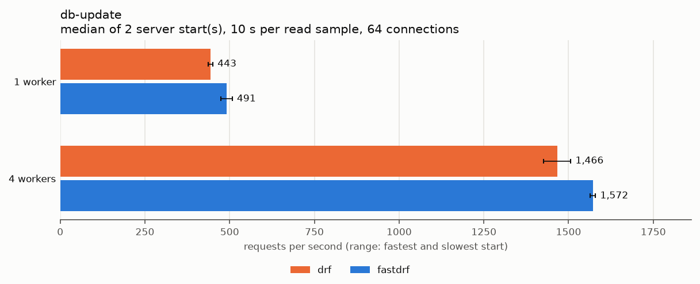

| Profile | Workers | req/s | Spread | p50 ms | p99 ms | CPU % | PostgreSQL | oha |
| --- | ---: | ---: | ---: | ---: | ---: | ---: | ---: | ---: |
| drf | 1 | 443 | ±1.5% | 141.78 | 182.73 | 98 | 7% | 0% |
| fastdrf | 1 | 491 | ±3.3% | 129.10 | 151.24 | 97 | 7% | 0% |
| drf | 4 | 1,466 | ±2.7% | 23.79 | 121.45 | 348 | 24% | 1% |
| fastdrf | 4 | 1,572 | ±0.5% | 24.23 | 112.63 | 329 | 25% | 1% |

## Parameters

- Profiles: drf, fastdrf; workers: [1, 4]; Gunicorn gthread with 8 threads per worker
- Server CPUs: [0, 2, 4, 6] (one per worker); load generator CPUs: [8, 9, 10, 11, 12, 13, 14, 15]
- Repeats: 2; duration: 10 s per read sample; warmup: 2 s; requests per write sample: 2000
- Concurrency: 64; order seed: 42
- Started: 2026-10-01T14:54:32.512990+00:00; finished: 2026-10-01T15:27:38.666309+00:00
- Load generator: oha 1.16.0

## Environment

- Python: 3.14.7 (main, Sep  1 2026, 14:18:09) [Clang 22.1.3 ]; GIL enabled: True
- Host: Intel(R) Core(TM) i7-14700F, 28 logical CPUs, 123.3 GiB; CPU frequency governor: powersave
- Platform: Linux-7.0.0-31-generic-x86_64-with-glibc2.43
- Packages: Django 6.1.1, djangorestframework 3.18.1, django-fastdrf 0.1.0, msgspec 0.22.0, pydantic 2.13.5, gunicorn 26.2.0, psycopg 3.3.6
- django-fastdrf 0.1.0: source `a9190ed88132`, installed from the package index
- Benchmark source: `18a91f463434` (commit none, working tree unknown)
- PostgreSQL: effective_cache_size 3GB, fsync on, max_connections 200, random_page_cost 1.1, server_version 18.6 (Debian 18.6-1.pgdg12+2), shared_buffers 512MB, synchronous_commit off, work_mem 8MB

Server commands:

- w1: `.venv/bin/python -m gunicorn bench.wsgi:application --bind 127.0.0.1:8180 --workers 1 --worker-class gthread --threads 8 --keep-alive 5 --backlog 2048 --timeout 60 --graceful-timeout 10 --log-level warning --error-logfile - --config python:bench.gunicorn_config`
- w4: `.venv/bin/python -m gunicorn bench.wsgi:application --bind 127.0.0.1:8180 --workers 4 --worker-class gthread --threads 8 --keep-alive 5 --backlog 2048 --timeout 60 --graceful-timeout 10 --log-level warning --error-logfile - --config python:bench.gunicorn_config`

## Files

`report/summary.csv` holds every group's numbers, `report/samples.json` every
sample and `report/manifest.json` the environment, the settings of both
profiles and what fastdrf does per case. The charts are in `report/graphs/`.
The raw output of each sample (load generator output, server log, resource
samples) stays in the run directory, which is not part of the repository.
